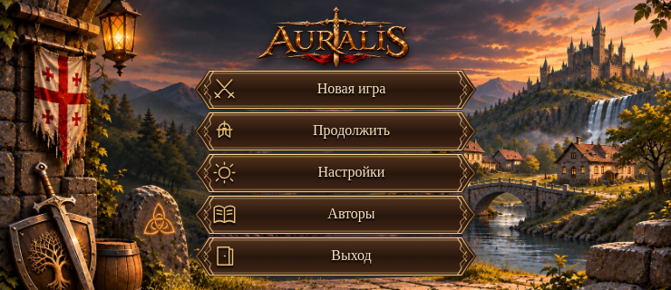
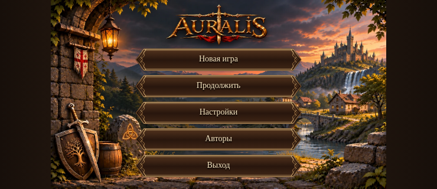
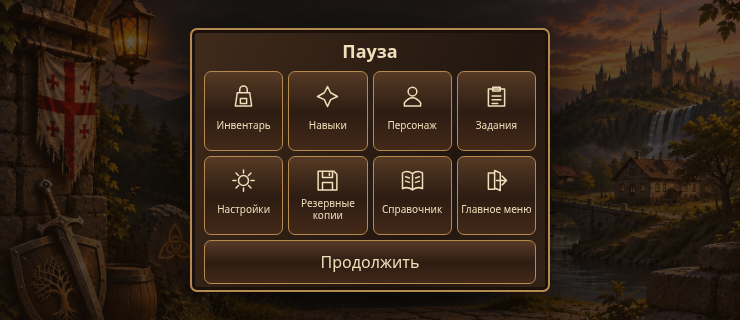
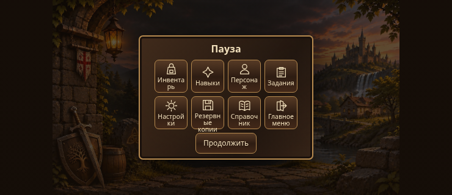
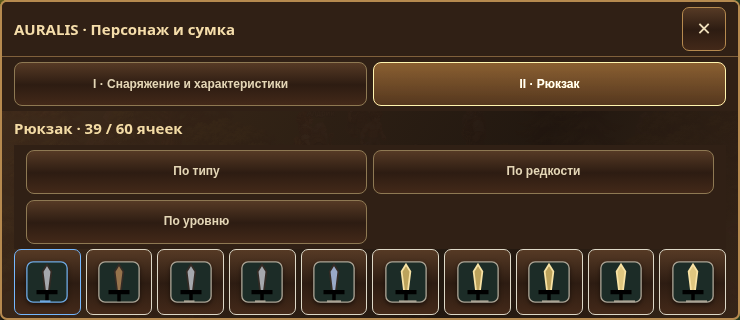
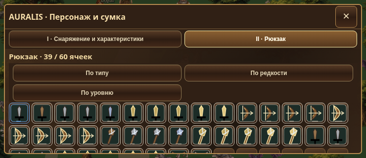
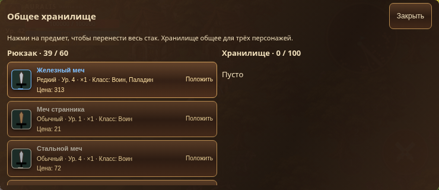
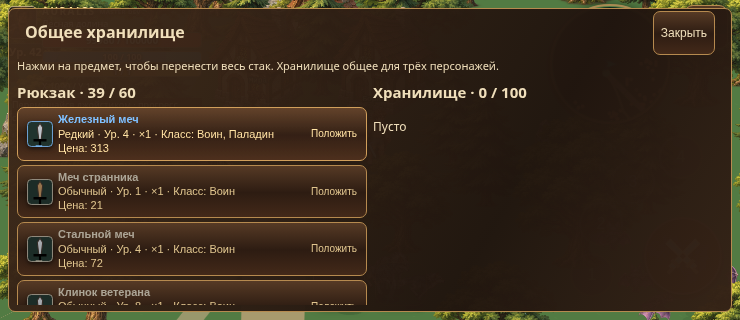

# Сравнение интерфейса

Одинаковый viewport740×320, русский язык, выпуск16 до и опубликованный выпуск17 после. Новая версия не меняет геометрию боевых контролов. Полные raw метрики — work/task5-before/metrics.json и work/task5-after/metrics.json; сохранённый baseline управления — ../task5-control-baseline.json.

| Окно | До | После |
|---|---|---|
| Главное меню |  |  |
| Пауза |  |  |
| Рюкзак |  |  |
| Хранилище |  |  |

После: список хранилища прокручивается независимо от окна. Строки с несколькими уровнями информации выше ориентира36px ради сохранения текста. Физическое Android-устройство для ручной оценки отсутствует.
